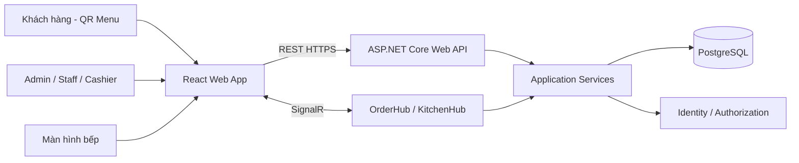
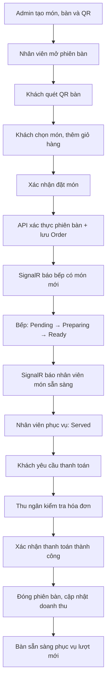
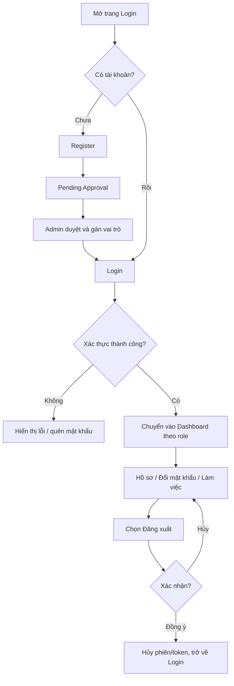
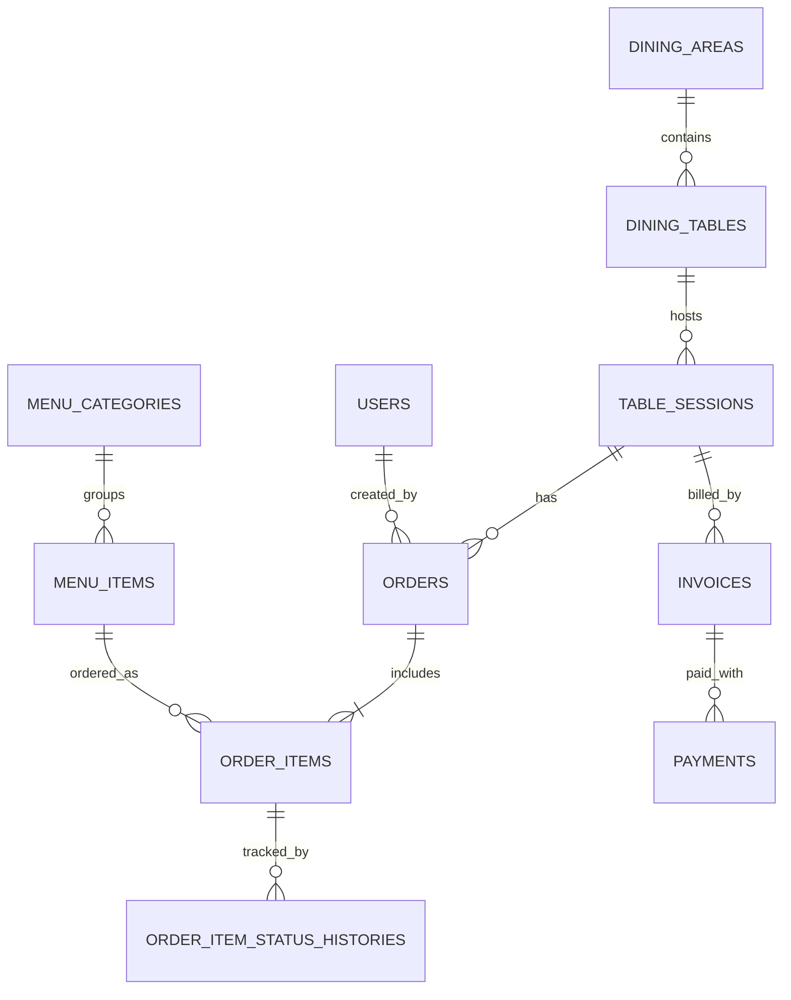

# 🍜 RESTO — Restaurant Order Management

> **Hệ thống quản lý nhà hàng và gọi món bằng mã QR**  
> **Công nghệ dự kiến:** React + TypeScript + ASP.NET Core Web API + PostgreSQL + SignalR  
> **Trạng thái hiện tại:** Đã có thiết kế Figma ban đầu và **HTML prototype tương tác**; **chưa triển khai hệ thống backend/database thực tế**.

RESTO hướng tới việc quản lý toàn bộ quy trình vận hành nhà hàng: **quản lý nhân viên → quản lý bàn → quản lý thực đơn → khách quét QR → đặt món → bếp chế biến → nhân viên phục vụ → lập hóa đơn → thanh toán → thống kê doanh thu**.

---

## 1. Tổng quan dự án

### 1.1. Bài toán

Nhiều quán ăn hiện quản lý bàn, nhận order và thanh toán thủ công. Cách làm này có thể gây nhầm món, thất lạc order, chậm chuyển thông tin tới bếp, khó biết bàn nào còn trống và khó tổng hợp doanh thu chính xác.

RESTO là một hệ thống đa vai trò kết hợp **quản trị trên web**, **màn hình bếp** và **menu QR trên điện thoại** nhằm tập trung dữ liệu và đồng bộ các thay đổi theo thời gian thực.

### 1.2. Mục tiêu

- Quản lý bàn và khu vực phục vụ, tình trạng bàn và phiên sử dụng bàn.
- Quản lý món ăn, danh mục, giá bán, tùy chọn món và tình trạng còn/hết món.
- Cho khách xem thực đơn và đặt món bằng QR tại bàn (không bắt buộc tạo tài khoản).
- Cho nhân viên nhận đơn, gọi thêm món và theo dõi tiến độ phục vụ.
- Cho bếp nhận đơn mới ngay lập tức và cập nhật trạng thái từng món.
- Cho thu ngân lập hóa đơn, ghi nhận thanh toán và kết thúc phiên bàn.
- Thống kê doanh thu, số đơn hàng, món bán chạy và hiệu suất vận hành.
- Cung cấp đăng nhập, đăng ký nhân viên, duyệt tài khoản, phân quyền, quản lý hồ sơ, đổi mật khẩu và đăng xuất.
- Thiết kế giao diện nhất quán, responsive, có sidebar menu xổ xuống và các thành phần UI tái sử dụng.

### 1.3. Phạm vi

**MVP (bắt buộc):** Xác thực/phân quyền, quản lý bàn, thực đơn, QR menu, tạo order, hiển thị bếp realtime, trạng thái món, hóa đơn, xác nhận thanh toán và doanh thu cơ bản.

**Nâng cao (sau MVP):** Đặt bàn trước, quản lý nguyên liệu/tồn kho, chia/gộp hóa đơn, khuyến mãi, khách hàng thân thiết, máy in bếp, thanh toán online tích hợp thật, nhiều chi nhánh và thông báo nâng cao.

---

## 2. Trạng thái tài liệu và sản phẩm hiện tại

| Hạng mục | Trạng thái | Ghi chú |
|---|---|---|
| Thiết kế RESTO trên Figma | **Đã có bản ban đầu** | 10 màn hình: 8 desktop + 2 mobile; layer có thể chỉnh sửa |
| Component menu xổ xuống Figma | **Đã tạo mẫu** | Có hai trạng thái mở/đóng và reaction prototype; **chưa đồng bộ vào mọi sidebar** |
| HTML UI prototype | **Đã có** | Đăng nhập demo, đăng ký demo, sidebar xổ xuống, quản lý nhà hàng, profile, modal đăng xuất, vai trò mẫu |
| React frontend sản phẩm | **Chưa xác nhận triển khai** | HTML demo không phải ứng dụng React hoàn chỉnh |
| ASP.NET Core Web API | **Chưa triển khai trong prototype** | Cần lập trình nghiệp vụ và bảo vệ endpoint |
| PostgreSQL | **Chưa kết nối với prototype** | Dữ liệu đang hard-code/phục vụ minh họa |
| SignalR realtime | **Chưa kết nối thật** | UI bếp/order đang dùng dữ liệu demo |
| JWT/ASP.NET Core Identity | **Chưa có xác thực thật** | Tài khoản demo không an toàn cho production |
| QR thật / thanh toán thật | **Chưa có** | UI hiện chỉ mô phỏng QR và xác nhận thanh toán |

**Lưu ý:** Các chỉ số như doanh thu, số bàn, số đơn, tài khoản demo và lịch sử giao dịch trong prototype là **dữ liệu giả lập**; không được coi là số liệu kinh doanh thật.

### 2.1. Tài nguyên thiết kế

- **Figma:** [Restaurant Order Management](https://www.figma.com/design/KHlHpnuUsNEGXlMuW954Mo/Restaurant-order-management)
- **Bản HTML preview:** `RESTO_Interactive_UI_Prototype.html`
- **Bộ đóng gói preview hiện có:** `RESTO_UI_Prototype_Package.zip`

> Các màn hình xác thực/hồ sơ mới trong HTML **chưa được thêm vào Figma gốc** do giới hạn số lượt Figma MCP của gói Starter ở lần chỉnh sửa gần nhất. Khi tiếp tục thiết kế Figma, cần đồng bộ các màn hình này và accordion sidebar trên toàn bộ desktop screen.

---

## 3. Công nghệ và kiến trúc dự kiến

| Tầng | Công nghệ | Nhiệm vụ |
|---|---|---|
| Frontend | React, TypeScript, Vite | Dashboard, sơ đồ bàn, menu, order, bếp, thu ngân, QR menu |
| Routing | React Router | Điều hướng theo trang và quyền |
| State | Redux Toolkit hoặc TanStack Query + Context | Quản lý auth state, UI state, server data |
| HTTP | Fetch/Axios | Gọi API, quản lý response và lỗi |
| Backend | ASP.NET Core Web API (.NET 8 hoặc bản LTS được chọn) | Xác thực, nghiệp vụ, API, validation |
| Data access | EF Core + Npgsql | ORM, migrations, giao dịch PostgreSQL |
| Database | PostgreSQL | Lưu dữ liệu bền vững |
| Realtime | ASP.NET Core SignalR | Gửi thông báo đơn/trạng thái món/bàn realtime |
| Authentication | ASP.NET Core Identity + JWT/Cookie phù hợp | Đăng nhập, đăng xuất, quản lý tài khoản |
| Authorization | Role/policy-based | Phân quyền Admin, Staff, Kitchen, Cashier |
| QR | Thư viện tạo QR phía server hoặc client | Tạo liên kết tới menu của bàn với token hợp lệ |
| Test | xUnit + ASP.NET Core Integration Tests; Vitest/Playwright | Kiểm thử nghiệp vụ, API và luồng người dùng |

### 3.1. Kiến trúc tổng thể



**Nguyên tắc:** Mọi thay đổi nghiệp vụ phải được xác minh và lưu thông qua API/backend. SignalR gửi **sự kiện thông báo**, không thay thế việc ghi dữ liệu. Sau khi reconnect SignalR, client cần gọi API để tải trạng thái mới nhất.

---

## 4. Vai trò và phân quyền

> **Lưu ý:** Bảng dưới đây mô tả phân quyền **prototype/MVP**. Mô hình production có Super Admin, Owner, Manager, phân quyền chi tiết theo tenant/chi nhánh và ma trận quyền tại **mục 22–23**.


| Vai trò | Phạm vi chức năng chính |
|---|---|
| **Admin** | Toàn quyền quản trị: dashboard, nhân viên/phân quyền, bàn, menu, order, bếp, thanh toán, báo cáo, cấu hình và nhật ký |
| **Staff** | Xem bàn, menu, order; tạo/gọi thêm món, theo dõi trạng thái và phục vụ |
| **Kitchen** | Xem danh sách món cần chế biến, cập nhật `Preparing` / `Ready`; không được can thiệp thanh toán |
| **Cashier** | Xem bàn, đơn hàng, hóa đơn, xử lý thanh toán, lịch sử thu ngân, báo cáo được cho phép |
| **Customer** | Truy cập QR menu theo phiên bàn hợp lệ, đặt món và xem tình trạng order; không có quyền quản trị |

**Tình trạng trong HTML prototype:** Có 4 tài khoản demo (Admin, Staff, Kitchen, Cashier); màn hình menu được lọc theo role ở frontend để minh họa. **Ở sản phẩm thật, bắt buộc kiểm tra quyền tại từng API**. Không thể chỉ ẩn menu để bảo vệ dữ liệu.

### 4.1. Đăng ký và duyệt tài khoản

- Tài khoản đăng ký mới cung cấp: họ tên, email, mật khẩu, xác nhận mật khẩu.
- Không cho phép người tự đăng ký tự chọn `Admin` hoặc tự nâng quyền.
- Tài khoản nhân viên mới mặc định là **PendingApproval** (chờ Admin duyệt); chỉ được sử dụng chức năng sau khi kích hoạt.
- Admin có thể duyệt/từ chối, cấp role, khóa tài khoản, vô hiệu hóa nhân viên nghỉ việc và xem nhật ký thay đổi quyền.
- QR Customer là luồng truy cập riêng: không yêu cầu khách tự đăng ký tài khoản nhân viên.

---

## 5. Toàn bộ menu sidebar và chức năng con

Sidebar desktop gồm **8 nhóm menu**, bấm vào tiêu đề hoặc chevron để **mở/thu gọn (accordion)**. Khi mở một nhóm, những mục con tương ứng xuất hiện. Trang đang truy cập được highlight; các nhóm bị hạn chế bởi vai trò không được hiển thị.

```text
RESTO / RESTAURANT OS
│
├── 1. Tổng quan
│   ├── Dashboard
│   ├── Hoạt động hôm nay
│   └── Thông báo hệ thống
│
├── 2. Quản lý bàn
│   ├── Sơ đồ bàn
│   ├── Khu vực & tầng
│   ├── Đặt bàn trước
│   └── Mã QR từng bàn
│
├── 3. Thực đơn
│   ├── Danh sách món ăn
│   ├── Danh mục món
│   ├── Món còn / hết
│   └── Giá bán & tùy chọn
│
├── 4. Đơn hàng
│   ├── Tất cả đơn hàng
│   ├── Đơn mới nhận
│   ├── Lịch sử đơn hàng
│   └── Hủy món & hoàn món
│
├── 5. Bếp & chế biến
│   ├── Màn hình bếp (KDS)
│   ├── Món chờ chế biến
│   ├── Món hoàn thành
│   └── Lịch sử chế biến
│
├── 6. Thanh toán
│   ├── Hóa đơn chờ thu
│   ├── Thanh toán tại quầy
│   ├── Lịch sử giao dịch
│   └── Hoàn tiền / hủy hóa đơn
│
├── 7. Báo cáo
│   ├── Doanh thu
│   ├── Món bán chạy
│   ├── Báo cáo đơn hàng
│   └── Hiệu suất phục vụ
│
└── 8. Hệ thống
    ├── Nhân viên & vai trò
    ├── Hồ sơ cá nhân
    ├── Bảo mật tài khoản
    ├── Cài đặt hệ thống
    └── Nhật ký hoạt động
```

### 5.1. Chi tiết nghiệp vụ của từng nhóm

| Nhóm | Các thao tác cần hỗ trợ khi lập trình thật |
|---|---|
| Tổng quan | KPI doanh thu theo ngày, đơn hàng gần đây, số bàn trống/đang phục vụ, cảnh báo đơn chờ lâu, thông báo realtime |
| Quản lý bàn | CRUD khu vực/bàn, bàn trống/đặt trước/đang phục vụ/chờ thanh toán, mở/đóng phiên, xem QR, lịch sử phiên |
| Thực đơn | CRUD món và danh mục, giá, hình ảnh, thứ tự hiển thị, trạng thái hết món, tùy chọn món (ít cay, topping), tìm kiếm/lọc |
| Đơn hàng | Tạo order tại bàn, thêm món, cập nhật số lượng hợp lệ, gửi bếp, xem timeline, hủy món theo quyền, lịch sử |
| Bếp | Xếp đơn theo thời gian, nhóm món đang chờ/đang nấu/sẵn sàng, cập nhật từng order item, cảnh báo chậm |
| Thanh toán | Hóa đơn, chiết khấu/thuế theo cấu hình, xác nhận tiền mặt/chuyển khoản, in/xuất hóa đơn, hoàn/hủy có kiểm soát |
| Báo cáo | Doanh thu theo ngày/tuần/tháng, tổng đơn, món bán chạy, doanh thu theo món, thời gian ra món và tỉ lệ hủy |
| Hệ thống | Hồ sơ nhà hàng, lịch làm việc, nhân viên và vai trò, thông báo, thay đổi mật khẩu, nhật ký thao tác, cấu hình |

---

## 6. Các màn hình giao diện

### 6.1. Các màn hình Figma ban đầu

1. **Admin Dashboard** — KPI, biểu đồ doanh thu, số bàn, đơn hàng gần đây.
2. **Table Management** — sơ đồ bàn, chọn khu vực, trạng thái bàn và chi tiết phiên.
3. **Menu Management** — danh mục món, danh sách món, giá bán và còn/hết món.
4. **Order Management** — danh sách order, trạng thái và theo dõi order.
5. **Kitchen Display (KDS)** — các cột món chờ, đang chế biến, hoàn thành.
6. **Billing & Payment** — chi tiết hóa đơn, tổng tiền, phương thức thanh toán.
7. **Revenue Reports** — KPI và biểu đồ doanh thu, món bán chạy.
8. **Sign In** — màn hình đăng nhập ban đầu.
9. **Customer QR Menu** — menu mobile dành cho khách.
10. **Customer Cart & Checkout** — giỏ hàng và xác nhận đặt món mobile.

### 6.2. Các trang/bộ phận bổ sung trong HTML prototype

- **Login:** email, mật khẩu, ghi nhớ đăng nhập, liên kết đăng ký/quên mật khẩu.
- **Register:** họ tên, email, mật khẩu, xác nhận mật khẩu; tài khoản mới ở trạng thái chờ duyệt trong demo.
- **Forgot Password:** nhập email; thông báo mô phỏng (chưa gửi email thật).
- **Registration Pending:** thông báo tài khoản chờ Admin duyệt.
- **Profile:** avatar, họ tên, email, role, cập nhật tên hiển thị demo.
- **Security:** đổi mật khẩu (UI mẫu, chưa thay đổi mật khẩu trên server).
- **Avatar dropdown:** hồ sơ, bảo mật, cài đặt, đổi sáng/tối, đăng xuất.
- **Logout confirmation:** modal xác nhận trước khi rời hệ thống.
- **Notifications:** danh sách thông báo, đánh dấu đã đọc trong UI demo.
- **System:** nhân viên, phân quyền, cài đặt, nhật ký và các trang quản trị bổ sung.
- **Accordion sidebar:** mở/đóng 8 nhóm, các mục con hiển thị theo quyền.
- **Responsive:** có giao diện sidebar mobile và giao diện sáng/tối minh họa.

### 6.3. Thanh topbar đề xuất

```text
[☰]   [⌕ Tìm kiếm bàn, món, order...]    [● Hoạt động]   [🔔]  [Avatar ▾]
                                                                  │
                                                                  ├ Hồ sơ của tôi
                                                                  ├ Đổi mật khẩu
                                                                  ├ Cài đặt
                                                                  ├ Chế độ sáng / tối
                                                                  └ Đăng xuất
```

**Thiết kế đề xuất:** Sidebar cố định trên desktop, thu gọn được trên mobile; trạng thái active rõ ràng; badge số thông báo; skeleton/loading/error/empty states; modal xác nhận với các hành động rủi ro; responsive cho tablet, desktop và điện thoại.

---

## 7. Luồng hoạt động của hệ thống

### 7.1. Quy trình gọi món từ QR đến thanh toán



**Quy tắc quan trọng:** Khách có thể gọi thêm món trong cùng phiên bàn, nhưng mỗi lần gửi có thể là một order mới. Không tự động ghi doanh thu cho order chưa được thanh toán.

### 7.2. Quy trình xác thực và đăng xuất



**Bắt buộc ở bản thật:** Mật khẩu phải được hash an toàn (dùng Identity/password hasher); logout cần làm mất hiệu lực phiên/refresh token theo thiết kế; không lưu mật khẩu thô, không chỉ xóa state UI. Nếu dùng access token ngắn hạn, cần chiến lược thu hồi refresh token và bảo vệ cookie/CSRF phù hợp.

---

## 8. Quản lý trạng thái nghiệp vụ

### 8.1. Trạng thái bàn / phiên

- **Available:** bàn trống, không có phiên mở.
- **Reserved:** đã đặt trước (nếu bật tính năng này).
- **Occupied:** có phiên đang phục vụ.
- **PendingPayment:** đã yêu cầu thanh toán, chưa xác nhận.
- **Cleaning** *(tùy chọn)*: đang dọn bàn trước khi phục vụ lượt mới.

Nên tách **trạng thái đặt bàn** và **trạng thái phiên bàn** trong dữ liệu, tránh dùng một cột đơn lẻ cho nhiều ý nghĩa.

### 8.2. Trạng thái từng món (OrderItem)

```text
Pending → Preparing → Ready → Served
       └────────────→ Cancelled (nếu được phép theo quy tắc)
```

- `Pending`: món đã được nhận, chưa chế biến.
- `Preparing`: bếp đang chế biến.
- `Ready`: bếp hoàn thành, chờ phục vụ.
- `Served`: nhân viên đã phục vụ.
- `Cancelled`: món được hủy theo quy tắc và ghi lý do.

Order tổng thể có thể tính trạng thái dựa trên các OrderItem. Tránh đặt trạng thái toàn order thành `Served` khi vẫn còn một món đang nấu.

### 8.3. Trạng thái thanh toán

```text
Unpaid → PendingConfirmation → Paid
                └────────────→ Failed / Cancelled
Paid → Refunded / PartiallyRefunded (theo quyền và điều kiện)
```

Thanh toán bằng chuyển khoản **không được tự coi là thành công chỉ vì khách chọn phương thức chuyển khoản**. Cần xác nhận tại quầy hoặc kiểm tra callback/webhook hợp lệ từ cổng thanh toán.

---

## 9. Thiết kế cơ sở dữ liệu PostgreSQL (đề xuất)

Đây là **mô hình mục tiêu cần triển khai**, không phải danh sách bảng đã được tạo trong sản phẩm.

| Bảng | Trường / mục đích chính |
|---|---|
| `Users` (Identity) | `Id`, `FullName`, `Email`, `PasswordHash`, `IsActive`, `ApprovalStatus`, `CreatedAt` |
| `Roles`, `UserRoles` | Role và liên kết người dùng; có thể dùng bảng ASP.NET Core Identity |
| `DiningAreas` | `Id`, `Name`, `Floor`, `IsActive` |
| `DiningTables` | `Id`, `AreaId`, `TableNumber`, `Capacity`, `IsActive` |
| `TableReservations` *(nâng cao)* | `Id`, `TableId`, `CustomerName`, `Phone`, `ReservedAt`, `Status` |
| `TableSessions` | `Id`, `TableId`, `OpenedAt`, `ClosedAt`, `OpenedBy`, `Status`, `Version` |
| `TableQrTokens` | `Id`, `TableId`, `SessionId`, `TokenHash`, `ExpiresAt`, `RevokedAt` |
| `MenuCategories` | `Id`, `Name`, `DisplayOrder`, `IsActive` |
| `MenuItems` | `Id`, `CategoryId`, `Name`, `Description`, `Price`, `ImageUrl`, `IsAvailable` |
| `MenuItemOptions` *(nâng cao)* | `Id`, `MenuItemId`, `Name`, `PriceDelta` |
| `Orders` | `Id`, `SessionId`, `OrderNumber`, `CreatedAt`, `CreatedBy`, `Status`, `Note` |
| `OrderItems` | `Id`, `OrderId`, `MenuItemId`, `Quantity`, `UnitPrice`, `ItemStatus`, `Note` |
| `OrderItemStatusHistories` | `Id`, `OrderItemId`, `FromStatus`, `ToStatus`, `ChangedBy`, `ChangedAt`, `Reason` |
| `Invoices` | `Id`, `SessionId`, `InvoiceNumber`, `Subtotal`, `Discount`, `Tax`, `Total`, `Status`, `IssuedAt` |
| `Payments` | `Id`, `InvoiceId`, `Method`, `Amount`, `Status`, `TransactionRef`, `PaidAt` |
| `Refunds` *(nâng cao)* | `Id`, `PaymentId`, `Amount`, `Reason`, `ApprovedBy`, `CreatedAt` |
| `Notifications` | `Id`, `RecipientUserId`, `Type`, `Payload`, `IsRead`, `CreatedAt` |
| `AuditLogs` | `Id`, `ActorUserId`, `Action`, `Entity`, `EntityId`, `Timestamp`, `Metadata` |
| `RestaurantSettings` | `Id`, `Name`, `Phone`, `Address`, `OpeningHours`, `TaxConfig` |

### 9.1. Quan hệ dữ liệu



### 9.2. Ràng buộc cần có

1. Một bàn chỉ có **tối đa một phiên phục vụ đang mở** tại một thời điểm (ràng buộc unique có điều kiện hoặc cơ chế giao dịch tương đương).
2. Lưu **`OrderItems.UnitPrice` tại thời điểm đặt**, không tính hóa đơn lịch sử dựa trên giá menu hiện tại.
3. `Quantity > 0`, `UnitPrice >= 0`, số tiền và thuế phải dùng kiểu `decimal`/`numeric`, không dùng `float` cho tiền.
4. Tạo order, lưu chi tiết và phát sự kiện nghiệp vụ phải được phối hợp nhất quán, ví dụ **transaction + outbox** nếu cần đảm bảo delivery.
5. Chống tạo order trùng khi khách nhấn nhiều lần hoặc retry: dùng **idempotency key** phía server.
6. Chống thanh toán trùng: unique constraint trên transaction reference hoặc idempotency key; kiểm soát cạnh tranh bằng transaction/lock.
7. Dữ liệu đã thanh toán không được bị sửa tùy tiện; hủy/hoàn phải có lịch sử và role được phép.
8. Dùng `CreatedAt`, `UpdatedAt`, `CreatedBy` và lịch sử thay đổi khi phù hợp. Chuẩn hóa timestamp UTC trong database, hiển thị múi giờ Việt Nam ở frontend.
9. Phân tách thao tác xóa mềm món/nhân viên để không làm hỏng hóa đơn/đơn hàng lịch sử.

---

## 10. Thiết kế API dự kiến

Tất cả route dưới đây là **đề xuất để triển khai**, không phải API đang chạy trong HTML demo.

| Nhóm | Endpoint ví dụ | Mục đích |
|---|---|---|
| Auth | `POST /api/auth/login` | Đăng nhập |
| Auth | `POST /api/auth/register` | Đăng ký nhân viên, tạo trạng thái chờ duyệt |
| Auth | `POST /api/auth/refresh` | Gia hạn phiên theo chính sách xác thực |
| Auth | `POST /api/auth/logout` | Đăng xuất/thu hồi refresh token |
| Auth | `POST /api/auth/forgot-password` | Khởi tạo quy trình đặt lại mật khẩu |
| Auth | `POST /api/auth/reset-password` | Đổi mật khẩu bằng token hợp lệ |
| Auth | `GET /api/auth/me` | Thông tin tài khoản hiện tại |
| Users | `GET /api/users` | Danh sách nhân viên (Admin) |
| Users | `PATCH /api/users/{id}/approve` | Duyệt tài khoản |
| Users | `PATCH /api/users/{id}/roles` | Gán vai trò theo quyền |
| Profile | `PUT /api/profile` | Cập nhật hồ sơ |
| Profile | `POST /api/profile/change-password` | Đổi mật khẩu |
| Tables | `GET /api/tables` | Danh sách bàn, trạng thái, khu vực |
| Tables | `POST /api/tables` | Thêm bàn |
| Sessions | `POST /api/tables/{id}/sessions` | Mở phiên bàn |
| Sessions | `POST /api/table-sessions/{id}/close` | Đóng phiên đã thanh toán |
| QR | `POST /api/table-sessions/{id}/qr-token` | Cấp QR token có hạn |
| Menu | `GET /api/menu/items` | Lấy món, filter/search |
| Menu | `POST /api/menu/items` | Thêm món (quản trị) |
| Categories | `GET /api/menu/categories` | Danh mục món |
| Customer | `GET /api/public/menu?token=...` | Menu công khai cho bàn có token hợp lệ |
| Customer | `POST /api/public/orders` | Khách gửi order theo token và idempotency key |
| Orders | `GET /api/orders` | Lọc order theo quyền và trạng thái |
| Orders | `POST /api/orders` | Nhân viên tạo order |
| Orders | `POST /api/orders/{id}/items` | Thêm món vào order theo chính sách |
| Kitchen | `GET /api/kitchen/orders` | Lấy hàng chờ chế biến |
| Kitchen | `PATCH /api/order-items/{id}/status` | Cập nhật trạng thái từng món |
| Invoices | `POST /api/table-sessions/{id}/invoice` | Tạo hóa đơn phiên bàn |
| Payments | `POST /api/invoices/{id}/payments` | Ghi nhận thanh toán đã xác minh |
| Reports | `GET /api/reports/revenue` | Báo cáo doanh thu |
| Reports | `GET /api/reports/top-items` | Thống kê món bán chạy |
| Audit | `GET /api/audit-logs` | Tra nhật ký quản trị (Admin) |

### 10.1. Response API tiêu chuẩn (gợi ý)

```json
{
  "success": true,
  "data": {},
  "message": "Operation completed",
  "errors": [],
  "requestId": "example-id"
}
```

Ở bản thật, lỗi HTTP phải trả **status code đúng** (`400`, `401`, `403`, `404`, `409`, `422`, `500` tùy trường hợp), không luôn trả `200` với `success: false`.

---

## 11. SignalR / Realtime

**Hub đề xuất:** `/hubs/restaurant` hoặc tách `/hubs/orders`, `/hubs/kitchen`.

| Event | Người nhận | Khi nào phát |
|---|---|---|
| `OrderCreated` | Kitchen, Staff liên quan | Đơn mới được lưu thành công |
| `OrderItemStatusChanged` | Kitchen, Staff, phiên khách nếu cần | Một món chuyển trạng thái |
| `OrderReady` | Staff/Bàn liên quan | Có món sẵn sàng mang ra |
| `TableStatusChanged` | Staff, Cashier, Admin | Bàn mở phiên, đóng phiên, chờ thanh toán |
| `PaymentCompleted` | Cashier, Staff, Admin | Thanh toán đã được server ghi nhận |
| `NotificationCreated` | Người dùng/nhóm được quyền | Cảnh báo hoạt động mới |

Quy tắc realtime:

- Nhóm SignalR (`Groups`) phải dựa trên **role/restaurant/session được backend xác thực**, không tin `tableId` do client tự khai.
- Mọi event nên có `eventId`, `entityId`, `version` hoặc thời điểm phát để client cập nhật an toàn.
- Khi reconnect: gọi API lấy snapshot mới, đối chiếu dữ liệu để không bỏ lỡ sự kiện.
- Không gửi thông tin nhạy cảm/PII không cần thiết trong payload công khai.

---

## 12. Thiết kế QR Menu

### 12.1. Chức năng phía khách

- Quét QR mở URL menu dành cho một bàn/phiên hợp lệ.
- Xem tên món, ảnh, mô tả, giá, danh mục và tình trạng còn món.
- Thêm/xóa món khỏi giỏ, chọn số lượng, nhập ghi chú.
- Xem tạm tính, xác nhận đặt món và nhận mã order.
- Xem trạng thái món nếu hệ thống cho phép.
- Có thể gọi thêm món khi phiên bàn vẫn mở.

### 12.2. Bảo mật QR

- **Không dùng duy nhất URL `?tableId=5` làm căn cứ cho phép order.**
- Cần token ngẫu nhiên khó đoán, có thời hạn và liên kết tới phiên bàn, hoặc cơ chế xác thực tương đương được server quản lý.
- Kiểm tra token còn hạn, chưa thu hồi, bàn đang phục vụ và món còn được phép bán.
- Rate limit, validate số lượng món, xác minh giá và tổng tiền trên backend.
- Khi kết thúc phiên bàn, token QR của phiên phải hết hiệu lực.
- QR in cố định có thể dẫn tới bước xác minh phiên bàn bổ sung; tránh cho người ngoài tạo order trái phép chỉ vì biết URL cũ.

---

## 13. Hóa đơn, thanh toán, doanh thu

### 13.1. Công thức cơ bản

```text
Subtotal = Σ (OrderItem.Quantity × OrderItem.UnitPrice) - giá trị món hủy hợp lệ
Total    = Subtotal - Discount + ApplicableTax + ApplicableServiceFee
Revenue  = Tổng giá trị giao dịch đã thanh toán hợp lệ trong kỳ,
           có điều chỉnh khoản hoàn/hủy theo quy tắc báo cáo.
```

- Xử lý thuế, phí phục vụ, khuyến mãi theo **cấu hình thực tế** thay vì giả định mức cố định.
- Tổng tiền tính ở **server**; client chỉ trình bày.
- Thanh toán có thể là tiền mặt hoặc chuyển khoản (MVP). Tích hợp cổng thanh toán online ở giai đoạn nâng cao.
- Tạo báo cáo dựa trên `Payments`/`Invoices` hợp lệ, không lấy từ tổng các order đang chờ.
- Cho phép in hóa đơn/xuất bản PDF khi tích hợp máy in hoặc thư viện PDF.

---

## 14. Cấu trúc thư mục dự kiến khi lập trình

```text
Restaurant-Order-Management/
├── README.md
├── .gitignore
├── .env.example
├── docs/
│   ├── requirements.md
│   ├── architecture.md
│   ├── erd.md
│   ├── api-spec.md
│   └── ui-flow.md
├── design/
│   └── RESTO_Interactive_UI_Prototype.html
├── backend/
│   ├── Restaurant.sln
│   ├── Restaurant.Api/
│   │   ├── Controllers/
│   │   ├── Hubs/
│   │   ├── Middleware/
│   │   └── Program.cs
│   ├── Restaurant.Application/
│   │   ├── DTOs/
│   │   ├── Interfaces/
│   │   ├── Services/
│   │   └── Validators/
│   ├── Restaurant.Domain/
│   │   ├── Entities/
│   │   ├── Enums/
│   │   └── Events/
│   └── Restaurant.Infrastructure/
│       ├── Persistence/
│       ├── Migrations/
│       ├── Repositories/
│       └── Identity/
├── frontend/
│   ├── src/
│   │   ├── app/
│   │   ├── api/
│   │   ├── components/
│   │   ├── layouts/
│   │   ├── features/
│   │   │   ├── auth/
│   │   │   ├── dashboard/
│   │   │   ├── tables/
│   │   │   ├── menu/
│   │   │   ├── orders/
│   │   │   ├── kitchen/
│   │   │   ├── payments/
│   │   │   ├── reports/
│   │   │   └── settings/
│   │   ├── hooks/
│   │   ├── services/
│   │   └── types/
│   └── package.json
├── tests/
│   ├── Restaurant.IntegrationTests/
│   └── frontend-e2e/
└── scripts/
```

> **Đây là cấu trúc đề xuất**, không có nghĩa là tất cả thư mục/file này đã tồn tại trong project hiện tại.

### 14.1. Route React dự kiến

| Route | Màn hình |
|---|---|
| `/login` | Đăng nhập |
| `/register` | Đăng ký nhân viên |
| `/forgot-password` | Quên mật khẩu |
| `/pending-approval` | Tài khoản chờ duyệt |
| `/admin/dashboard` | Dashboard Admin |
| `/app/tables` | Sơ đồ bàn |
| `/app/menu` | Thực đơn quản lý |
| `/app/orders` | Đơn hàng |
| `/app/kitchen` | Bếp |
| `/app/payments` | Thanh toán |
| `/app/reports` | Báo cáo |
| `/app/staff` | Nhân viên và vai trò |
| `/app/profile` | Hồ sơ cá nhân |
| `/app/security` | Bảo mật tài khoản |
| `/app/settings` | Cài đặt hệ thống |
| `/menu/:qrToken` | QR Menu cho khách |
| `/menu/:qrToken/cart` | Giỏ hàng khách |

Tên route có thể điều chỉnh khi bắt đầu code để thống nhất authorization và layouts.

---

## 15. Cách mở bản HTML prototype hiện có

### Yêu cầu

- Trình duyệt hiện đại (Chrome, Edge, Safari hoặc Firefox).
- **Không cần Node.js, PostgreSQL, ASP.NET Core hay chạy server** để xem riêng bản HTML hiện tại.

### Chạy thử

1. Tải `RESTO_Interactive_UI_Prototype.html` cùng tài liệu này.
2. Mở trực tiếp file `.html` trong trình duyệt.
3. Đăng nhập bằng một trong những tài khoản demo dưới đây.
4. Trải nghiệm các sidebar, màn hình, modal và luồng quản trị minh họa.

### Tài khoản demo — **chỉ dùng trên prototype**

| Vai trò | Email | Mật khẩu demo |
|---|---|---|
| Admin | `admin@resto.vn` | `123456` |
| Staff | `staff@resto.vn` | `123456` |
| Kitchen | `kitchen@resto.vn` | `123456` |
| Cashier | `cashier@resto.vn` | `123456` |

**Không tái sử dụng các thông tin đăng nhập demo này cho hệ thống thật.**

### Tương tác demo đã có

- Accordion menu xổ xuống và lựa chọn các chức năng con.
- Đăng nhập theo role; chuyển trang mặc định theo role.
- Đăng ký tài khoản demo với trạng thái chờ duyệt (chưa tạo user thật trên server).
- Đăng xuất bằng modal xác nhận.
- Menu avatar: profile, bảo mật, cài đặt, theme, logout.
- Lọc thực đơn, chọn bàn, xem order/bếp, hiển thị KPI, thanh toán giả lập.
- Thông báo mẫu, một số tác vụ thao tác bằng modal/toast.

Một số nút chỉ mở thông báo/hiển thị dữ liệu mẫu. Những thao tác đó **không tạo dữ liệu bền vững**. Trang đăng ký demo không lưu mật khẩu thật, trang quên mật khẩu không gửi email và chức năng đổi mật khẩu chưa tích hợp server.

---

## 16. Hướng dẫn khởi tạo project thật (khi bắt đầu code)

> **Các lệnh sau là kế hoạch khởi tạo, không phải lệnh đã chạy trên một repository RESTO có sẵn.**

### 16.1. Yêu cầu môi trường

- .NET SDK phù hợp với phiên bản backend đã chọn.
- Node.js phiên bản LTS, npm (hoặc pnpm).
- PostgreSQL và công cụ quản lý DB như pgAdmin/psql.
- Git, VS Code / Visual Studio / Rider.

### 16.2. Tạo bộ khung backend

```bash
mkdir Restaurant-Order-Management
cd Restaurant-Order-Management
mkdir backend frontend docs tests
cd backend

dotnet new sln -n Restaurant
dotnet new webapi -n Restaurant.Api
dotnet new classlib -n Restaurant.Application
dotnet new classlib -n Restaurant.Domain
dotnet new classlib -n Restaurant.Infrastructure

dotnet sln add Restaurant.Api/Restaurant.Api.csproj
dotnet sln add Restaurant.Application/Restaurant.Application.csproj
dotnet sln add Restaurant.Domain/Restaurant.Domain.csproj
dotnet sln add Restaurant.Infrastructure/Restaurant.Infrastructure.csproj

dotnet add Restaurant.Api reference Restaurant.Application Restaurant.Infrastructure
dotnet add Restaurant.Application reference Restaurant.Domain
dotnet add Restaurant.Infrastructure reference Restaurant.Application Restaurant.Domain
```

Thêm EF Core Npgsql, Identity và SignalR theo phiên bản SDK/EF tương thích, sau đó cấu hình dependency injection, migrations, secrets và CORS. SignalR server đã tích hợp trong ASP.NET Core; không nhất thiết thêm một gói không cần thiết.

### 16.3. Tạo bộ khung frontend

```bash
cd ../frontend
npm create vite@latest . -- --template react-ts
npm install
npm install react-router-dom @reduxjs/toolkit react-redux @microsoft/signalr
npm run dev
```

Có thể chọn TanStack Query cho cache server data thay vì lưu toàn bộ API response trong Redux. Với backend được tạo bằng cấu hình mặc định, kiểm tra URL/HTTPS/port thực tế trước khi gọi API.

### 16.4. Biến môi trường mẫu

Frontend `frontend/.env.example`:

```dotenv
VITE_API_BASE_URL=http://localhost:5000
VITE_SIGNALR_URL=http://localhost:5000/hubs/restaurant
```

Backend dùng **User Secrets / environment variables** để đặt connection string và khóa xác thực, ví dụ tên cấu hình `ConnectionStrings__DefaultConnection`. **Không commit mật khẩu database, JWT signing keys hoặc secret thật lên Git.**

---

## 17. Lộ trình phát triển M0 → M10

| Milestone | Nội dung thực hiện | Tiêu chí hoàn thành |
|---|---|---|
| **M0** | Khởi tạo Git/solution/API/frontend/config; README, chuẩn code | React và API khởi động được; có cấu trúc rõ ràng |
| **M1** | Thiết kế ERD, entity, quan hệ, EF Core migrations | PostgreSQL tạo bảng đúng ràng buộc |
| **M2** | Identity/JWT, login/register/forgot password, pending approval, phân quyền, profile, logout | Test role và bảo mật qua API |
| **M3** | Quản lý khu vực, bàn, phiên bàn, trạng thái, QR token | Bàn và phiên hợp lệ; QR gắn đúng bàn |
| **M4** | Quản lý danh mục và món ăn; ảnh, giá, tình trạng món, tùy chọn | Admin CRUD; khách xem menu đúng dữ liệu |
| **M5** | Giỏ hàng và đặt món; transaction, idempotency, ghi giá order | Order lưu đúng, không bị gửi trùng |
| **M6** | Kitchen Display + SignalR | Bếp nhận đơn mới và cập nhật không cần refresh |
| **M7** | Trạng thái từng món, lịch sử, notify phục vụ, quyền hủy | Món chuyển trạng thái đúng luồng |
| **M8** | Hóa đơn, tiền mặt/chuyển khoản, xác nhận, đóng phiên | Tránh thanh toán trùng; bàn trở lại available |
| **M9** | Dashboard, doanh thu, món bán chạy, lọc theo ngày | Báo cáo khớp giao dịch thành công |
| **M10** | Integration/E2E tests, responsive, kiểm tra bảo mật, deploy và tài liệu bàn giao | Demo luồng QR → order → bếp → thanh toán thành công |

### 17.1. Thứ tự ưu tiên cho MVP

1. **Database + Auth** (M0–M2).
2. **Bàn + Menu** (M3–M4).
3. **QR + Order** (M5).
4. **Bếp realtime + trạng thái món** (M6–M7).
5. **Thanh toán + đóng bàn** (M8).
6. **Báo cáo và kiểm thử** (M9–M10).

Không cần làm hết tính năng nâng cao trước khi hoàn thành **một luồng end-to-end hoạt động ổn định**.

---

## 18. Kiểm thử và tiêu chí nghiệm thu

### 18.1. Auth / Account

- [ ] Admin đăng nhập thành công và thấy đúng menu.
- [ ] Staff, Kitchen, Cashier bị chặn ở các endpoint không có quyền.
- [ ] Đăng ký mới không được tự chọn Admin; tài khoản chờ duyệt không truy cập dữ liệu nội bộ.
- [ ] Sai mật khẩu nhận thông báo an toàn; có throttling/rate limit.
- [ ] Quên mật khẩu có token một lần, hết hạn, không tiết lộ email tồn tại hay không.
- [ ] Đổi mật khẩu yêu cầu xác thực lại phù hợp; phiên cũ được xử lý theo chính sách.
- [ ] Đăng xuất thu hồi phiên/refresh token và trở về Login.

### 18.2. Bàn / QR / Order

- [ ] Không thể mở hai phiên đang hoạt động cùng một bàn.
- [ ] QR hết hạn/đã thu hồi không thể tạo order.
- [ ] Không thể tạo order ở bàn khác bằng cách sửa `tableId`.
- [ ] Giá sản phẩm được xác minh tại backend và lưu snapshot khi đặt món.
- [ ] Retry request không tạo trùng order.
- [ ] Hủy món có điều kiện, quyền và lý do.

### 18.3. Bếp / Realtime

- [ ] Bếp thấy đơn mới ngay khi API lưu thành công.
- [ ] Thay đổi trạng thái một món không làm sai trạng thái các món còn lại.
- [ ] Nhân viên nhận thông báo khi món `Ready`.
- [ ] Mất/kết nối lại SignalR không làm mất trạng thái đơn.

### 18.4. Thanh toán / Báo cáo

- [ ] Tổng hóa đơn đúng với món và quy tắc giảm giá/thuế.
- [ ] Hai lần bấm thanh toán không ghi trùng doanh thu.
- [ ] Bàn chỉ đóng theo điều kiện thanh toán chính xác.
- [ ] Giao dịch hoàn/hủy được ghi lịch sử và phản ánh báo cáo.
- [ ] Tổng doanh thu được tính từ thanh toán hợp lệ, không từ đơn chưa thu.

### 18.5. UI/UX

- [ ] Sidebar xổ/thu đúng nhóm; mục hiện hành nổi bật.
- [ ] Có trang login/register/forgot password/pending approval/profile/security/logout.
- [ ] Có loading/empty/error/success state và thông báo rõ ràng.
- [ ] Dùng được trên desktop, tablet và điện thoại; QR menu tối ưu mobile.
- [ ] Các input có label, keyboard focus, contrast và thông báo lỗi dễ hiểu.

---

## 19. Hướng nâng cấp giao diện Figma tiếp theo

**Đã có:** Figma bộ 10 màn hình ban đầu; một component menu xổ xuống trạng thái Expanded/Collapsed và interaction thử nghiệm.

**Cần bổ sung khi có lại quyền/lượt chỉnh sửa Figma:**

1. Đồng bộ sidebar accordion **8 nhóm** lên mọi màn hình desktop, kèm active state và điều hướng mục con.
2. Thêm **Register, Forgot Password, Pending Approval, Profile, Security, Logout Confirmation** dưới dạng frame/flow rõ ràng.
3. Gắn topbar dùng chung: Search, notifications, avatar dropdown, light/dark, logout.
4. Làm trang **Nhân viên & phân quyền** và **Cài đặt hệ thống** cụ thể, không chỉ màn hình dữ liệu mẫu.
5. Thiết kế các state của button/input/modal/card/table: default, hover, disabled, loading, error, empty.
6. Thêm ảnh món thật, icon nhất quán, bộ màu/spacing/typography tokens và component instances tái sử dụng.
7. Nối Prototype tương tác: login → dashboard; register → pending; avatar → profile/security/logout; nhóm menu → các trang tương ứng.
8. Kiểm tra responsive và handoff cho React theo tên component, route và API contract.

---

## 20. Cảnh báo bảo mật / sử dụng

- HTML prototype hiện tại chạy độc lập, **không dùng để vận hành nhà hàng thật**.
- Tài khoản/mật khẩu demo chỉ mang tính minh họa và dễ đoán.
- Tự kiểm tra quyền tại backend cho tất cả thao tác có dữ liệu nhạy cảm hoặc thay đổi tiền/order.
- Thiết lập HTTPS, CORS chặt chẽ, rate limiting, bảo vệ dữ liệu cá nhân, validation, logs và backup database.
- Nếu xuất hóa đơn theo quy định pháp luật hoặc tích hợp thanh toán điện tử thực tế, phải khảo sát quy định và nhà cung cấp tương ứng trước khi triển khai.
- Chỉ hiển thị và lưu dữ liệu cá nhân thực sự cần thiết.

---

## 21. Kết quả cuối cùng mong muốn

Một hệ thống RESTO hoàn chỉnh cho phép:

**Admin chuẩn bị thực đơn và bàn → Nhân viên mở phiên → Khách quét QR và đặt món → Bếp nhận order realtime → Nhân viên phục vụ → Thu ngân thanh toán → Đóng bàn → Quản lý xem báo cáo doanh thu.**

Kèm theo đó là hệ thống **đăng ký nhân viên → phê duyệt → đăng nhập theo vai trò → quản lý hồ sơ/bảo mật → đăng xuất an toàn**, với UI/UX chuyên nghiệp và bộ menu con rõ ràng để thuận tiện mở rộng.

---

**Tên dự án:** RESTO — Restaurant Order Management  
**Nguồn thiết kế:** [Figma RESTO](https://www.figma.com/design/KHlHpnuUsNEGXlMuW954Mo/Restaurant-order-management)  
**Tài liệu này:** Đặc tả định hướng và README cho quá trình phát triển; cập nhật trạng thái thực tế sau mỗi milestone.

---

## 22. Đặc tả mở rộng: RESTO Production-Ready (mục tiêu xây dựng)

> **Trạng thái:** Toàn bộ nội dung mục 22–29 là **yêu cầu/thiết kế đề xuất**, **chưa phải chức năng đã triển khai**. Các phần trước mô tả bản demo/MVP. Khi có mâu thuẫn về phân quyền hoặc phạm vi, áp dụng mô hình chặt chẽ hơn trong các mục mới cho phiên bản production.

### 22.1. Phạm vi sản phẩm và đối tượng sử dụng

RESTO được thiết kế như một nền tảng quản lý nhà hàng có thể vận hành tại **một hoặc nhiều chi nhánh** và có khả năng hỗ trợ **nhiều nhà hàng độc lập (multi-tenant)**. Một tổ chức/nhà hàng (tenant) có nhiều chi nhánh; dữ liệu nhân viên, menu, bàn, đơn, thanh toán phải được cách ly theo tenant và giới hạn theo chi nhánh được phân công.

- **Super Admin (nền tảng):** quản lý tenant, trạng thái thuê bao, hỗ trợ vận hành, cấu hình cấp nền tảng; không tự động được xem dữ liệu nhạy cảm của khách hàng hay giao dịch của mọi tenant nếu không có cơ chế hỗ trợ được ủy quyền, ghi log và giới hạn thời gian.
- **Owner (chủ nhà hàng):** cấu hình nhà hàng, quản lý chi nhánh, phân quyền quản lý, xem báo cáo tổng hợp tenant.
- **Manager (quản lý chi nhánh):** vận hành bàn, menu, nhân viên, duyệt ngoại lệ đơn hàng, báo cáo trong các chi nhánh được giao.
- **Waiter / Staff (phục vụ):** mở phiên bàn, nhận/gửi order, cập nhật phục vụ, yêu cầu thanh toán, xem dữ liệu các bàn/ca được giao.
- **Kitchen Staff (bếp):** nhận phiếu chế biến, cập nhật trạng thái món, ghi nhận hết món; không xem doanh thu hoặc thông tin thanh toán.
- **Cashier (thu ngân):** lập hóa đơn, thu tiền, xác nhận giao dịch, đối soát ca, thực hiện hoàn tiền khi có quyền/phê duyệt.
- **Customer (khách):** quét QR với token phiên bàn hợp lệ, xem menu, gọi món và theo dõi trạng thái order của phiên; không cần tài khoản nhân viên.

**Quy tắc:** Một người dùng có thể có nhiều vai trò, nhưng quyền phải được xét theo **tenant + branch + role + permission + điều kiện của tài nguyên**. Không mặc định Super Admin/Owner được bỏ qua mọi bước kiểm soát nhạy cảm.

## 23. RBAC: vai trò, quyền và phạm vi

### 23.1. Ma trận phân quyền tối thiểu

Ký hiệu: **✓** = cho phép trong phạm vi được cấp; **D** = chỉ khi được duyệt hoặc cấp quyền đặc biệt; **—** = mặc định từ chối.

| Hành động | Super Admin | Owner | Manager | Staff | Kitchen | Cashier | Customer |
|---|:---:|:---:|:---:|:---:|:---:|:---:|:---:|
| Quản lý tenant/gói dịch vụ | ✓ | — | — | — | — | — | — |
| Quản lý chi nhánh | — | ✓ | D | — | — | — | — |
| Tạo/khóa nhân viên, gán role | — | ✓ | D | — | — | — | — |
| Cấu hình bàn/khu vực/QR | — | ✓ | ✓ | D | — | — | — |
| Tạo/sửa menu, giá bán | — | ✓ | ✓ | — | — | — | — |
| Xem menu và trạng thái món | — | ✓ | ✓ | ✓ | ✓ | ✓ | ✓ |
| Mở phiên bàn / gửi order | — | ✓ | ✓ | ✓ | — | D | ✓* |
| Xem đơn trong phạm vi công việc | — | ✓ | ✓ | ✓ | ✓** | ✓ | ✓* |
| Cập nhật trạng thái chế biến | — | ✓ | ✓ | — | ✓ | — | — |
| Hủy món đã gửi bếp | — | ✓ | D | D | — | — | — |
| Tạo hóa đơn / thu tiền | — | ✓ | D | — | — | ✓ | — |
| Hoàn tiền / hủy giao dịch | — | D | D | — | — | D | — |
| Xem báo cáo doanh thu | — | ✓ | ✓ | — | — | D | — |
| Xem audit log nghiệp vụ | D | ✓ | D | — | — | — | — |

\* Khách chỉ được thao tác trên **phiên bàn đang mở** đã được xác minh bằng token, với các điều kiện chống giả mạo và giới hạn số lần gọi.  
\** Bếp chỉ thấy thông tin chế biến cần thiết, không thấy thông tin thanh toán hoặc dữ liệu cá nhân không liên quan.

### 23.2. Danh mục permission đề xuất

```text
platform.tenants.manage
restaurants.read / restaurants.update
branches.read / branches.create / branches.update
users.read / users.invite / users.disable
roles.read / roles.assign / permissions.manage
tables.read / tables.manage / tables.open / tables.transfer / tables.merge
qr.generate / qr.rotate
menu.read / menu.create / menu.update / menu.price.update / menu.availability.update
orders.read / orders.create / orders.add_item / orders.cancel_item / orders.approve_cancel
kitchen.read / kitchen.start / kitchen.ready
service.mark_served
invoices.read / invoices.create / invoices.split / invoices.void
payments.read / payments.collect / payments.refund / payments.approve_refund
cash_shifts.open / cash_shifts.close / cash_shifts.reconcile
inventory.read / inventory.receive / inventory.adjust / recipes.manage
reports.sales.read / reports.operations.read / reports.export
audit.read / settings.manage
```

**Thực thi:** dùng ASP.NET Core Identity cho tài khoản, policy-based authorization cho permission; `AuthorizationHandler` kiểm tra tenant/branch và trạng thái tài nguyên. Không tin `restaurantId`, `branchId`, `role`, giá món hoặc tổng tiền do client gửi. Backend tự lấy phạm vi quyền từ identity và database; kiểm tra mỗi lần truy cập. React chỉ ẩn/hiện UI theo quyền nhằm cải thiện trải nghiệm, **không phải lớp bảo mật**.

### 23.3. Vòng đời tài khoản

1. **Đăng ký chủ nhà hàng:** xác minh email; tạo tenant mới; xác lập Owner thông qua quy trình onboarding được bảo vệ.
2. **Nhân viên:** Owner/Manager được ủy quyền **mời** nhân viên bằng email, gán vai trò và chi nhánh; nhân viên nhận link một lần để tạo mật khẩu. Không có đăng ký công khai để tự nhận vai trò nhân viên.
3. **Đăng nhập:** kiểm tra mật khẩu băm bằng Identity, trạng thái email/tài khoản, tenant và chi nhánh; giới hạn thử sai; MFA cho Owner, Manager và vai trò nhạy cảm.
4. **Phiên đăng nhập:** access token ngắn hạn hoặc cookie bảo mật; refresh token xoay vòng, lưu hash, thu hồi khi logout/đổi mật khẩu/khóa tài khoản. Nếu dùng cookie: SameSite, HttpOnly, Secure và CSRF protection phù hợp; nếu dùng JWT: kiểm soát XSS, lưu trữ token an toàn.
5. **Quên/đổi mật khẩu:** token một lần có hạn; xác minh email; thu hồi phiên theo chính sách; không tiết lộ email có tồn tại hay không.
6. **Đăng xuất:** thu hồi phiên/refresh token, xóa cookie/token hợp lệ; điều hướng về `/login`; thao tác nhạy cảm yêu cầu xác thực lại khi cần.
7. **Nhật ký:** ghi lại login thành công/thất bại, khóa tài khoản, đổi role, thu hồi phiên; hạn chế lưu PII và không log mật khẩu/token.

## 24. Sitemap giao diện production

### 24.1. Trang công khai và tài khoản

| Route đề xuất | Mục đích |
|---|---|
| `/login` | Đăng nhập nhân viên/quản trị |
| `/register` | Đăng ký chủ nhà hàng, onboarding tenant |
| `/verify-email` | Xác minh email |
| `/forgot-password`, `/reset-password` | Khôi phục mật khẩu |
| `/onboarding` | Tạo nhà hàng/chi nhánh đầu tiên |
| `/account/profile` | Hồ sơ cá nhân, avatar, liên hệ |
| `/account/security` | Đổi mật khẩu, MFA, phiên đăng nhập |
| `/account/notifications` | Cài đặt thông báo |
| `/logout` | Hành động kết thúc phiên và trở về login, **không cần trang dashboard riêng** |
| `/q/:qrToken` | Menu QR của phiên bàn hợp lệ |
| `/q/:qrToken/cart`, `/q/:qrToken/orders` | Giỏ hàng và theo dõi món của khách |

### 24.2. Sidebar sau đăng nhập (accordion)

| Nhóm menu | Các trang con |
|---|---|
| **Tổng quan** | Dashboard; Hoạt động hôm nay; Thông báo; Việc cần xử lý |
| **Quản lý bàn** | Sơ đồ bàn; Khu vực & tầng; Đặt bàn trước; Phiên bàn; QR từng bàn; Chuyển/ghép bàn |
| **Thực đơn** | Danh sách món; Danh mục; Tùy chọn món/topping; Combo; Tình trạng còn/hết; Giá và lịch sử thay đổi |
| **Đơn hàng** | Đơn mới; Tất cả đơn; Đơn đang phục vụ; Gọi thêm món; Hủy món chờ duyệt; Lịch sử đơn |
| **Bếp & chế biến** | KDS; Món chờ làm; Đang chế biến; Món hoàn thành; Thời gian chế biến; Cảnh báo chậm |
| **Thanh toán** | Hóa đơn chờ thu; Thu tiền; Chia/gộp hóa đơn; Giao dịch; Hoàn tiền; Ca thu ngân; Đối soát |
| **Kho & nguyên liệu** | Nguyên liệu; Nhà cung cấp; Nhập/xuất kho; Định lượng công thức; Kiểm kê; Cảnh báo tồn |
| **Khách hàng & ưu đãi** | Khách hàng; Voucher/khuyến mãi; Khách hàng thân thiết; Lịch sử ưu đãi |
| **Báo cáo** | Doanh thu; Số đơn; Món bán chạy; Hiệu suất bàn/bếp; Báo cáo ca; Xuất CSV/Excel |
| **Nhân sự & phân quyền** | Nhân viên; Lời mời; Vai trò; Quyền; Phân công chi nhánh; Ca làm; Audit log |
| **Cài đặt** | Nhà hàng; Chi nhánh; Thuế/phí; Máy in; Thanh toán; Thông báo; Bảo mật; Sao lưu |

**UI:** Sidebar có icon, chevron, mục đang chọn, badge số đơn chờ, trạng thái mở/đóng; nhớ trạng thái accordion theo phiên. Topbar có tìm kiếm, chọn chi nhánh, chuông thông báo, avatar, menu `Hồ sơ / Bảo mật / Cài đặt / Đăng xuất`. Có trang 403 (không đủ quyền), 404, lỗi mạng, loading, empty state và xác nhận trước hành động nguy hiểm. Menu được lọc theo permission và branch, không hiển thị các chức năng bị cấm. Giao diện responsive cho tablet, mobile và KDS.

## 25. Quy trình nghiệp vụ và các trường hợp ngoại lệ

### 25.1. Bàn, QR và order

1. Staff mở `TableSession` tại bàn; backend xác minh bàn chưa có phiên mở và cấp token QR không đoán được, có thời hạn/khả năng thu hồi.
2. Khách quét QR; server xác minh token, tenant, branch, table, session còn hiệu lực và chính sách order.
3. Khách chọn món/topping, số lượng, ghi chú; backend xác minh món còn bán, giá/thuế/phí và tính lại tổng; lưu snapshot giá, tên món, tùy chọn tại thời điểm đặt.
4. API tạo order trong transaction, sử dụng idempotency key để chống gửi trùng; ghi `OrderItems`, `OrderStatusHistory`, outbox event.
5. SignalR thông báo đến đúng nhóm bếp/nhân viên của branch; bếp cập nhật từng món `Pending → Preparing → Ready`; Staff đánh dấu `Served`.
6. Khách gọi thêm món tạo order mới cùng `TableSession`. Hủy món, sửa món đã chế biến cần policy và audit; không xóa lịch sử.
7. Khi kết thúc, thu ngân tạo invoice từ các món hợp lệ; áp dụng khuyến mãi, phí, thuế theo cấu hình và quy định; xác nhận thanh toán rồi đóng phiên bàn, thu hồi QR.

**Ngoại lệ bắt buộc:** bàn đã mở; hai khách gửi order cùng lúc; hết món sau khi thêm vào giỏ; mạng yếu; bếp nhận trùng sự kiện; chuyển/ghép bàn; hủy món sau khi bắt đầu nấu; món trả lại; thanh toán thiếu/thừa; hai thu ngân cùng xác nhận; mất kết nối SignalR; đóng bàn khi còn món chưa xử lý.

### 25.2. Thanh toán và đối soát

- Không coi `PaymentRequested` là đã thanh toán. Trạng thái tối thiểu: `Pending`, `Authorized` (nếu áp dụng), `Succeeded`, `Failed`, `Refunded`, `PartiallyRefunded`.
- Thanh toán chuyển khoản/cổng điện tử chỉ được xác nhận thành công khi nhận bằng chứng tin cậy từ đối tác (webhook có xác minh chữ ký hoặc đối soát), **không dựa vào ảnh chụp hoặc nút bấm của khách**.
- Dùng idempotency key, transaction và ràng buộc database để tránh ghi tiền trùng; webhook phải chịu được gửi lại và đến không đúng thứ tự.
- Hỗ trợ chia hóa đơn, thanh toán nhiều lần, giảm giá có quyền, hoàn tiền có phê duyệt; tổng tiền đã thu và hoàn phải được đối soát với invoice.
- Ca thu ngân: mở ca, tiền đầu ca, tiền thu, chi điều chỉnh có lý do, kết ca, chênh lệch và người duyệt.
- Doanh thu báo cáo từ giao dịch đủ điều kiện, xử lý hoàn tiền và múi giờ/tiền tệ chính xác; không lấy số tiền chỉ từ trạng thái order.

### 25.3. Kho và định lượng (giai đoạn mở rộng)

Món ăn có `Recipe`/`RecipeIngredients`, nguyên liệu có đơn vị đo, tồn theo chi nhánh và nhật ký điều chỉnh. Quy định rõ thời điểm trừ kho (khi xác nhận chế biến hoặc hoàn tất, tùy chính sách), xử lý hủy/trả món và tránh trừ trùng. Nhập kho, kiểm kê và điều chỉnh có người thực hiện, lý do và lịch sử.

## 26. Cơ sở dữ liệu production (đề xuất bổ sung)

| Nhóm | Bảng chính |
|---|---|
| Multi-tenant | `Tenants`, `Restaurants`, `Branches`, `BranchSettings` |
| IAM | `Users`, `Roles`, `Permissions`, `UserRoles`, `RolePermissions`, `StaffAssignments`, `Invitations`, `RefreshTokens`, `LoginSessions` |
| Vận hành | `DiningAreas`, `DiningTables`, `TableSessions`, `Reservations`, `QrTokens` |
| Menu | `MenuCategories`, `MenuItems`, `MenuItemOptions`, `MenuItemOptionValues`, `Combos`, `BranchMenuAvailability`, `PriceHistories` |
| Order/bếp | `Orders`, `OrderItems`, `OrderItemOptions`, `OrderStatusHistories`, `KitchenTickets`, `OutboxEvents` |
| Thanh toán | `Invoices`, `InvoiceLines`, `Payments`, `PaymentTransactions`, `Refunds`, `CashShifts`, `CashShiftMovements`, `Discounts` |
| Kho | `Ingredients`, `Recipes`, `RecipeIngredients`, `Suppliers`, `StockBalances`, `StockMovements`, `PurchaseReceipts`, `StockCounts` |
| Quản trị | `AuditLogs`, `Notifications`, `NotificationPreferences`, `SystemSettings`, `IdempotencyRecords` |

**Quy ước:** PK UUID hoặc ID thích hợp; FK và unique constraints; timestamps UTC; `tenant_id`/`branch_id` ở bảng nghiệp vụ tương ứng; soft-delete cho đối tượng cấu hình nhưng **không xóa mềm thay thế cho lịch sử tài chính bất biến**; version/concurrency token để tránh cập nhật đè. Các chỉ mục theo tenant, branch, session, status, created_at. Xem xét row-level security như lớp bổ sung, không thay cho kiểm tra quyền ứng dụng. Migration được review và backup trước khi triển khai.

## 27. Kiến trúc backend, frontend và realtime

```text
React + TypeScript + Vite
  ├─ Auth / Route guards / Permission-aware navigation
  ├─ Admin / Manager / Staff / Kitchen / Cashier / Customer QR
  ├─ React Query (server state) + UI state management
  └─ SignalR client (event notifications + API refetch)
                  │ HTTPS
ASP.NET Core Web API (.NET 8 LTS hoặc LTS được chọn tại triển khai)
  ├─ Auth (ASP.NET Core Identity, policy + resource authorization)
  ├─ Restaurant/Branch, Staff, Menu, Table, Order, Kitchen
  ├─ Invoice, Payment, Reports, Inventory
  ├─ Validation, rate limits, audit, idempotency
  ├─ SignalR Hubs (tenant/branch-scoped groups)
  └─ Background jobs / Transactional Outbox
                  │
PostgreSQL + EF Core migrations
  ├─ Business transactions / concurrency / constraints
  └─ Outbox, audit, reporting views
```

- **REST API** là nguồn sự thật; SignalR chỉ gửi thông báo thay đổi. Client refetch sau reconnect; nhóm SignalR phải được cấp quyền phía server và kiểm tra tenant/branch.
- **DTO + validation** cho mọi request; dùng `ProblemDetails`, mã lỗi nhất quán, pagination/filter/sort, OpenAPI và versioning khi cần.
- **Outbox** đảm bảo sự kiện được gửi sau khi transaction commit; consumer xử lý idempotent. Không broadcast dữ liệu nhạy cảm tới toàn bộ user.
- **Báo cáo** ưu tiên query được tối ưu hoặc read model; không chạy truy vấn tổng hợp nặng làm nghẽn API order.
- **Môi trường** tách Development / Staging / Production; secrets qua environment/secret manager; không commit mật khẩu/connection string.

### 27.1. Các nhóm API chính

```text
/api/auth/*                       đăng nhập, đăng xuất, refresh, reset password, MFA
/api/me/*                         hồ sơ, phiên, thiết lập cá nhân
/api/tenants/*                    onboarding/quản trị tenant (đúng phạm vi)
/api/branches/*                   chi nhánh, cấu hình
/api/staff/*                      mời nhân viên, phân công, khóa tài khoản
/api/roles/*                      vai trò và quyền
/api/tables/*                     bàn, khu vực, phiên, chuyển/ghép
/api/qr/*                         phát hành/thu hồi token QR
/api/menu/*                       món, danh mục, giá, tùy chọn, tình trạng
/api/orders/*                     order, gọi thêm, hủy, lịch sử
/api/kitchen/*                    phiếu bếp, tiến độ chế biến
/api/invoices/*                   lập/tách/hủy hóa đơn theo quyền
/api/payments/*                   thanh toán, hoàn tiền, webhook
/api/cash-shifts/*                mở/kết ca, đối soát
/api/inventory/*                  tồn kho, định lượng, kiểm kê
/api/reports/*                    báo cáo và xuất dữ liệu
/api/audit-logs/*                 nhật ký theo quyền
/hubs/restaurant                  SignalR theo tenant/branch
```

## 28. Bảo mật, chất lượng và tiêu chí nghiệm thu production

### 28.1. Yêu cầu phi chức năng

- HTTPS bắt buộc; CORS allowlist; CSP và phòng chống XSS/CSRF; chống SQL injection qua EF parameterized queries; không lưu thẻ thanh toán nhạy cảm.
- Rate limit login, QR, order, webhook; lockout hợp lý; CAPTCHA/risk controls khi có abuse; secrets rotation và least privilege cho database.
- Log có correlation ID, metrics, health checks, tracing, cảnh báo lỗi; ẩn dữ liệu nhạy cảm trong log; audit bất biến theo chính sách lưu trữ.
- Backup PostgreSQL định kỳ, kiểm tra **restore thực tế**, kế hoạch RPO/RTO và xử lý sự cố; chính sách lưu trữ/xóa dữ liệu cá nhân.
- Hỗ trợ lỗi mạng, reconnect SignalR, timezone Việt Nam hiển thị phù hợp, định dạng VND, accessibility và responsive.
- Đối với hóa đơn điện tử, thuế và dữ liệu cá nhân: rà soát yêu cầu pháp luật hiện hành và tích hợp nhà cung cấp hợp lệ trước khi vận hành thật.

### 28.2. Các test bắt buộc

1. User tenant A không thể xem/sửa dữ liệu tenant B dù đoán được ID; Staff không gọi được API sửa giá; Kitchen không gọi được API thanh toán.
2. Nhân viên bị khóa/thu hồi role không thể tiếp tục dùng session cũ theo chính sách; refresh token bị thu hồi không hoạt động.
3. QR token giả/hết hạn/đã thu hồi không tạo được order; order không thể gắn sai bàn/chi nhánh.
4. Hai yêu cầu order trùng idempotency key chỉ tạo một order; hai thu ngân xác nhận cùng hóa đơn không ghi tiền hai lần.
5. Webhook thanh toán giả hoặc gửi lại không được ghi nhận sai; refund không vượt quá số tiền đủ điều kiện.
6. Giá món thay đổi không làm thay đổi hóa đơn đã lập; dữ liệu doanh thu phản ánh hoàn tiền và điều chỉnh.
7. KDS mất mạng rồi kết nối lại vẫn hiển thị đúng trạng thái; sự kiện đến trễ không ghi đè trạng thái mới hơn.
8. Audit lưu actor, hành động, thời điểm, phạm vi, lý do và kết quả cho hủy món, hoàn tiền, thay quyền.
9. Kiểm thử unit, integration với PostgreSQL thật/Testcontainers, E2E theo vai trò, tải đồng thời và backup/restore.

**Definition of Done:** Một chức năng chỉ được đánh dấu hoàn thành khi có UI, API, migration (nếu cần), authorization, validation, xử lý lỗi, audit (nếu nhạy cảm), tests, tài liệu và chạy được trên staging.

## 29. Lộ trình mở rộng để đạt phiên bản vận hành thực tế

| Pha | Phạm vi | Kết quả cần chứng minh |
|---|---|---|
| **P0 – Nền tảng** | Repo, CI, database, tenant/branch, auth, RBAC, onboarding, audit cơ bản | Đăng ký Owner, mời Staff, phân quyền chéo tenant được chặn |
| **P1 – Nhà hàng & menu** | Khu vực, bàn, phiên, QR, menu, topping, giá, availability | Quét QR đúng bàn, món/giá hợp lệ |
| **P2 – Order & bếp** | Order, gọi thêm, KDS, SignalR, trạng thái món, outbox | Nhiều khách đặt cùng lúc, bếp realtime, reconnect an toàn |
| **P3 – Thanh toán** | Invoice, tiền mặt, chuyển khoản/cổng thật, refund, ca thu ngân | Không ghi trùng tiền, đối soát và audit đầy đủ |
| **P4 – Vận hành nâng cao** | Đặt bàn, chuyển/ghép bàn, tách bill, ưu đãi, kho/nguyên liệu | Các ngoại lệ nghiệp vụ được kiểm thử |
| **P5 – Quản trị & báo cáo** | Dashboard theo quyền, export, multi-branch, logs, thông báo | Báo cáo đúng phạm vi và khớp dữ liệu thanh toán |
| **P6 – Production** | Security review, load test, monitoring, backups, DR, staging, deploy | Checklist go-live, diễn tập khôi phục và nghiệm thu người dùng |

### Những gì chưa được triển khai ở thời điểm viết tài liệu

- Các mục 22–29 **là đặc tả mục tiêu**, không phải bằng chứng RESTO đã có hệ thống production.
- File Figma hiện có bản UI ban đầu; prototype HTML là mô phỏng, chưa có xác thực, API, DB hay thanh toán thật.
- Khi bắt đầu code, ưu tiên **P0 → P3** tạo một chuỗi nghiệp vụ có kiểm soát quyền và thanh toán đúng; sau đó mở rộng P4 → P6.

---

## 30. Đồng bộ với giao diện HTML do nhóm chỉnh sửa

**Nguồn giao diện hiện tại:** `Restaurant Order Management_UI.html` (bản người dùng đã chỉnh sửa). Khi triển khai React, **ưu tiên giao diện, tên chức năng, cấu trúc điều hướng và bảng màu của file này** thay vì ghi đè bằng mockup RESTO cũ.

### 30.1. Quy chuẩn giao diện từ HTML mới

- Thương hiệu: **RESTO — Restaurant Order Management / RESTAURANT OS**.
- Giao diện quản trị: sidebar tối, nền nội dung sáng, thẻ dashboard, topbar tìm kiếm, breadcrumb, trạng thái hoạt động, chuông thông báo và menu avatar.
- **Bảng màu mới chủ đạo xanh navy – xanh dương**, thay cho cam chủ đạo của bản trước: `--nav: #07131d`, `--orange: #1b64a0`, `--orange2: #3d8fcb`, `--bg: #f2f5f8`, `--ink: #0c1a26`. Lưu ý biến CSS vẫn tên `--orange` nhưng giá trị thực tế là màu xanh.
- Font ưu tiên **Be Vietnam Pro**; hỗ trợ desktop/mobile, sidebar thu gọn trên mobile, chế độ sáng/tối.
- Sidebar accordion: nhấn tiêu đề nhóm để xổ/thu menu con; mục đang chọn có trạng thái active.
- Các nút trong prototype là mô phỏng. Không suy luận rằng mọi hành động đã kết nối backend.

### 30.2. Menu và tên mục theo đúng bản HTML đã chỉnh sửa

| Nhóm sidebar | Các chức năng con hiện có trong HTML |
|---|---|
| Tổng quan | Dashboard, Hoạt động hôm nay, Thông báo hệ thống |
| Quản lý bàn | Sơ đồ bàn, Khu vực & tầng, Đặt bàn trước, Mã QR từng bàn |
| Thực đơn | Danh sách món ăn, Danh mục món, Món còn / hết, Giá bán & tuỳ chọn |
| Đơn hàng | Tất cả đơn hàng, Đơn mới nhận, Lịch sử đơn hàng, Hủy món & hoàn món |
| Bếp & chế biến | Màn hình bếp (KDS), Món chờ chế biến, Món hoàn thành, Lịch sử chế biến |
| Thanh toán | Hóa đơn chờ thu, Thanh toán tại quầy, Lịch sử giao dịch, Hoàn tiền / hủy hóa đơn |
| Báo cáo | Doanh thu, Món bán chạy, Báo cáo đơn hàng, Hiệu suất phục vụ |
| Hệ thống | Nhân viên & vai trò, Phân quyền vai trò, Hồ sơ cá nhân, Bảo mật tài khoản, Cài đặt hệ thống, Nhật ký hoạt động |

**Quy tắc triển khai:** Giữ nguyên tên tiếng Việt và thứ tự các mục trên làm mặc định. Khi bổ sung phân hệ mới (kho, chi nhánh, ca làm, khách hàng, khuyến mãi), đặt thành nhóm rõ ràng và chỉ hiển thị khi vai trò có quyền.

### 30.3. Những luồng đã có trong HTML (chỉ ở mức demo)

| Luồng | Hiện trạng HTML | Yêu cầu khi làm hệ thống thật |
|---|---|---|
| Đăng nhập | 4 tài khoản demo, kiểm tra bằng JavaScript | ASP.NET Core Identity, password hash, rate limit, xác thực máy chủ |
| Đăng ký | Nhập tên/email/mật khẩu; tài khoản mới hiện trạng thái **Staff (chờ duyệt)** | Quy trình đăng ký Owner riêng; nhân viên do Owner/Manager mời và phê duyệt |
| Quên mật khẩu | Thông báo mô phỏng, **không gửi email thật** | Token đặt lại mật khẩu một lần, hết hạn, gửi email qua dịch vụ an toàn |
| Đăng xuất | Modal xác nhận, xóa `state.user` trong giao diện | Thu hồi refresh token/phiên; dọn cookie và kết nối realtime |
| Hồ sơ / bảo mật | Sửa tên tại UI; đổi mật khẩu là mockup | API cập nhật hồ sơ, xác minh mật khẩu cũ, MFA, quản lý phiên |
| Phân quyền | Ma trận Admin/Staff/Kitchen/Cashier chỉnh tại biến JS `perm` | Quyền lưu DB, áp dụng qua policy và kiểm tra từng API + phạm vi dữ liệu |
| Bàn / món / đơn / bếp | Dữ liệu mẫu và thao tác giả lập | CRUD, state machine, transaction, SignalR, đồng bộ nhiều thiết bị |
| Thanh toán | Xác nhận demo, không chuyển tiền | Giao dịch thật, idempotency, webhook xác thực, đối soát và hoàn tiền |
| QR | Hiển thị mô phỏng mã QR | QR thật, token bàn/phiên an toàn, chống giả mạo |
| Báo cáo | Số liệu/biểu đồ mẫu | Tính từ giao dịch đã đối soát, lọc chi nhánh, xuất báo cáo |

**Không sử dụng mật khẩu demo `123456` trong môi trường thật.** Không dùng dữ liệu hoặc trạng thái JS ở trình duyệt làm nguồn quyết định phân quyền hay ghi nhận doanh thu.

### 30.4. Phân quyền nâng cấp để vận hành chính thức

Phân biệt **vai trò hệ thống** (Super Admin), **vai trò nhà hàng** (Owner, Manager) và **vai trò nghiệp vụ** (Staff, Kitchen, Cashier). Customer truy cập QR theo phiên bàn; không có quyền vào quản trị.

| Nghiệp vụ | Super Admin | Owner | Manager | Staff | Kitchen | Cashier | Customer |
|---|---|---|---|---|---|---|---|
| Quản lý tenant / gói dịch vụ | Có | Không | Không | Không | Không | Không | Không |
| Quản lý chi nhánh / nhân viên | Theo phạm vi hỗ trợ | Có | Theo ủy quyền | Không | Không | Không | Không |
| Cấp vai trò và quyền | Theo chính sách nền tảng | Có | Theo ủy quyền giới hạn | Không | Không | Không | Không |
| Sửa món / giá | Không mặc định | Có | Có | Chỉ xem | Chỉ xem món liên quan | Chỉ xem | Chỉ xem menu công khai |
| Tạo order / gọi thêm món | Không mặc định | Có | Có | Có | Không | Theo quyền | Có qua QR hợp lệ |
| Chế biến / hoàn thành món | Không mặc định | Theo quyền | Có | Không | Có | Không | Không |
| Thu tiền / hoàn tiền | Không mặc định | Có | Theo hạn mức | Không | Không | Theo hạn mức | Thanh toán đơn của mình |
| Xem báo cáo doanh thu | Không mặc định | Có | Theo chi nhánh | Không | Không | Theo phạm vi ca | Không |
| Xem audit log | Theo chính sách hỗ trợ | Có | Theo ủy quyền | Không | Không | Không | Không |

Quyền cần định nghĩa chi tiết theo `resource.action` (ví dụ `orders.create`, `orders.cancel`, `payments.refund`, `staff.invite`, `roles.assign`, `reports.view`) kèm `restaurant_id`, `branch_id` và, khi cần, quyền theo **ca làm, người tạo, hạn mức**. Kiểm tra quyền tại API, không chỉ ẩn sidebar.

### 30.5. Các màn hình nên bổ sung vào HTML/React

1. **Onboarding chủ nhà hàng:** tạo nhà hàng, xác minh email, chọn chi nhánh đầu tiên, cấu hình thông tin và giờ hoạt động.
2. **Quản lý tài khoản nhân viên:** danh sách, mời nhân viên, duyệt/từ chối, khóa/mở, đặt lại quyền, phân ca.
3. **Chi tiết vai trò & quyền:** permission matrix theo chức năng, phân quyền theo chi nhánh và nhật ký thay đổi.
4. **Quản lý chi nhánh / khu vực:** chuyển chi nhánh từ topbar, bảng thống kê đúng phạm vi.
5. **Khách hàng quét QR:** menu mobile, giỏ hàng, topping, ghi chú, xác nhận order, theo dõi trạng thái và gọi nhân viên.
6. **Quản lý kho:** nguyên liệu, công thức định lượng, nhập/xuất, kiểm kê, cảnh báo tồn.
7. **Thanh toán nâng cao:** tách/gộp bill, giảm giá có phê duyệt, hóa đơn, ca thu ngân, đối soát, hoàn tiền.
8. **Trung tâm thông báo:** order mới, món sẵn sàng, yêu cầu thanh toán, sự cố; phân phối theo vai trò.
9. **Quản trị & bảo mật:** MFA, phiên đăng nhập, audit log, cấu hình thuế/phí, sao lưu, trạng thái hệ thống.
10. **Trạng thái lỗi/ngoại lệ:** không có quyền (403), không tìm thấy (404), hết phiên (401), mất mạng, bàn đóng, món hết, giao dịch thất bại.

### 30.6. Tiêu chí triển khai đúng bản HTML

- Không sửa hoặc thay thế bản HTML người dùng đã chỉnh sửa nếu chưa có yêu cầu; xem đây là **UI reference**.
- Chuyển các màn hình sang React components và route thật; duy trì màu, font, bố cục và responsive.
- Mỗi menu con có route hoặc màn hình nghiệp vụ thực, không dùng bảng placeholder chung khi nghiệm thu.
- UI lấy quyền và dữ liệu từ API; backend luôn xác thực, kiểm tra policy, tenant/branch, validation.
- Không lưu token nhạy cảm trong localStorage; thiết kế phiên an toàn, CSRF phù hợp nếu dùng cookie.
- Thử E2E theo từng vai trò, gồm truy cập URL trực tiếp, thu hồi quyền, đa chi nhánh, đồng thời order và thanh toán.
- Phân biệt rõ trạng thái **Đã có giao diện demo / Đã có API / Đã kiểm thử / Sẵn sàng production** cho từng chức năng.

### 30.7. Thứ tự công việc tiếp theo

1. Khóa chuẩn UI theo file HTML mới; dựng React layout, router và design tokens.
2. Thiết kế tenant/branch, schema người dùng – vai trò – quyền và audit.
3. Làm Identity + RBAC + onboarding + phê duyệt tài khoản và đăng xuất an toàn.
4. Kết nối bàn, QR, menu, order, bếp, SignalR với API thật.
5. Hoàn thiện hóa đơn, thanh toán, báo cáo, kho và các trường hợp ngoại lệ.
6. Kiểm thử bảo mật, tích hợp, hiệu năng, sao lưu/khôi phục và triển khai staging trước production.

> **Trạng thái thực tế:** File HTML đã chỉnh sửa là **prototype giao diện**, còn mục 22–30 là **đặc tả triển khai**. Chưa có bằng chứng backend, database, thanh toán và phân quyền server-side đã hoàn thành.
